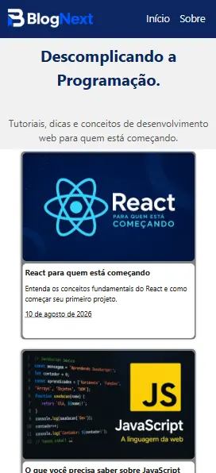

# BlogNext

Projeto criado como um desafio proposto pelo curso de **Desenvolvedor Front-End** na **EBAC** com o objetivo de criar um blog em que a página inicial lista os artigos disponíveis e cada artigo tem sua própria rota dinâmica, identificada por um slug.

Cada página exibe **titulo**, **autor**, **data de publicação** e **conteúdo**, alem de conter seus próprios Metadados e SEO.


## Tecnologias Utilizadas

- Next.js
- React
- TypeScript
- CSS Modules
- JSON
## Projeto Mobile

<p align="center">
    
</p>

## Como começar

Clone o repositório:

```bash
git clone https://github.com/QueirozVictor/Blog-Next.git
```

Entre na pasta do projeto:

```bash
cd Blog-Next
```

Instale as dependências:

```bash
npm install
```

Inicie o servidor de desenvolvimento:

```bash
npm run dev
```

Depois, acesse:

```text
http://localhost:3000
```

## Projeto online

[BlogNext](https://blog-next-lake-seven.vercel.app/)

## Autor

Victor Queiroz

[GitHub](https://github.com/QueirozVictor)
